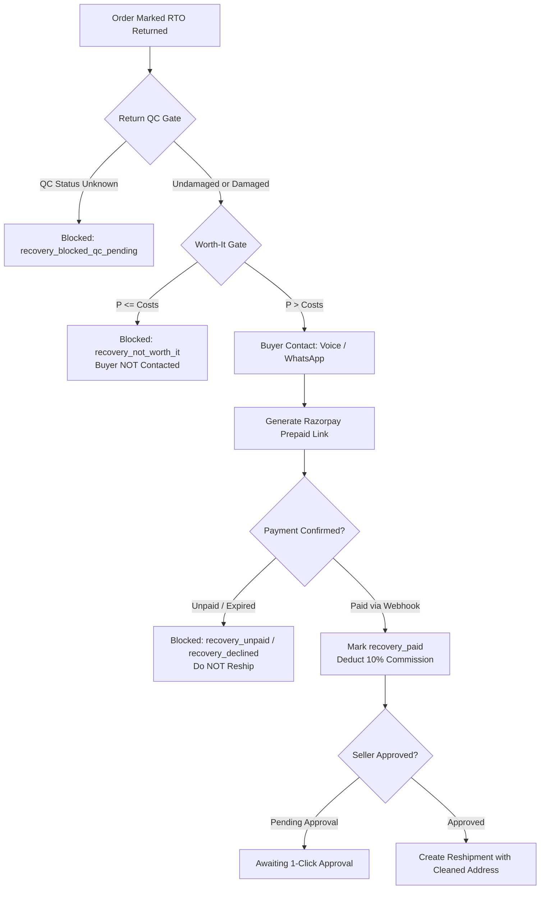

# TrustOrder by Shipvera — RTO Recovery Engine Specification

The **RTO Recovery Engine** is an autonomous system designed to recover sunken revenue from orders that have returned to origin (RTO).
Unlike initial verification which protects forward COD orders, RTO Recovery deals with returned inventory and operates under strict mathematical and operational gates.

---

## 1. CORE OPERATIONAL LAWS

### Law 1: PREPAID RECOVERY ONLY — COD RECOVERY NEVER
- **Zero COD Reshipments**: Never reship an RTO order on Cash on Delivery again. A buyer who has already failed or refused delivery once represents an extreme default risk.
- If the buyer refuses to pay prepaid in full via Razorpay, the order is marked `recovery_declined` or `recovery_unpaid`.
- **Any code path attempting to reship an RTO order on COD throws `COD_RESHIPMENT_FORBIDDEN` and logs `reship_status: 'blocked_cod'`.**

### Law 2: NO TRUST LOCK IN RECOVERY
- The ₹19 Trust Lock is strictly an initial pre-shipment friction tool for borderline buyers.
- Recovery requires **100% of the discounted product price prepaid upfront**.

### Law 3: REAL TRIGGERS ONLY
- Recovery triggers **ONLY** on authentic returns via:
  1. Real Shopify order return status / webhook (`return_status: 'returned'`)
  2. Real Shiprocket NDR / RTO delivered webhook
  3. Seller manual confirmation in dashboard
- Never synthesize or invent a fake RTO status.

---

## 2. THE THREE RECOVERY GATES



### Gate 1: Return Quality Control (QC) Gate
Before any recovery attempt is initiated, the returned physical parcel must be physically inspected by the merchant:
- **`undamaged`**: Product is in original reshippable condition (`new_product_cost = 0.00`).
- **`damaged`**: Product packaging or item is damaged and cannot be resold without manufacturing or replacing a new item (`new_product_cost > 0.00`).
- **`unknown`**: QC has not been performed yet. Recovery is immediately blocked with status `recovery_blocked_qc_pending`.

### Gate 2: The Worth-It Gate (Economic Protection)
TrustOrder evaluates whether recovery makes financial sense **BEFORE** reaching out to the buyer. If the transaction would result in a net loss or margin erosion, buyer contact is prevented.

#### Mathematical Formula:
$$\text{Recover ONLY if: } P > F + PK + C + CALL + NEW$$

Where:
- **$P$ (Product Price)**: Selling price after discount ($P_{\text{raw}} \times (1 - \text{discount}\%)$).
- **$F$ (Forward Shipping)**: Courier freight cost for the second delivery attempt (default: ₹80.00).
- **$PK$ (Packaging Cost)**: Secondary box, bubble wrap, and label printing (default: ₹20.00).
- **$C$ (Recovery Commission)**: TrustOrder platform success commission = $10\% \times P$.
- **$CALL$ (Telephony Cost)**: Recovery voice call / WhatsApp dispatch cost (typically ₹7.00 – ₹12.00).
- **$NEW$ (New Product Cost)**: Replacement cost if returned goods were damaged (₹0.00 if undamaged).

#### Outcome:
- **`worth_it_result = true`**: Recovery proceeds to buyer contact.
- **`worth_it_result = false`**: Marked `recovery_not_worth_it`. **Buyer is NEVER contacted**, and the seller is presented with the complete cost breakdown.

### Gate 3: Reshipment Release Gate
Reshipment can **ONLY** be triggered when **ALL** of the following conditions are met:
1. `payment_status === 'paid'` (confirmed via verified Razorpay webhook).
2. Seller approval explicitly granted in the dashboard (1-click approval; default `auto_approve = OFF`).
3. Corrected address is complete (house number, landmark, valid pincode). If address remains incomplete, reshipment is blocked (`blocked_address`).
4. Strict enforcement of prepaid courier label (COD disallowed).

---

## 3. BUYER CONTACT & HINGLISH SCRIPTING

Buyer contact occurs **ONLY** after the Worth-It Gate passes.

1. **Voice AI First**: 25-second Landmark Interrogator phone call:
   - *"Namaste [Name] ji! Main [Brand] ke dispatch desk se bol raha hoon. Aapka order kisi karan se return ho gaya tha. Kya aapka delivery address confirm kar sakte hain, aur agar hum aapko [X]% discount de toh kya aap prepaid payment kar denge?"*
2. **Meta WhatsApp Fallback**: Dispatched within the same credit if the voice call is unanswered or requests a payment link.
3. **Data Security & Privacy**:
   - AI **NEVER** asks for debit/credit card numbers, UPI PIN, CVV, OTP, or netbanking passwords.
   - All transactions occur strictly on secure Razorpay-hosted payment links.

---

## 4. APPEND-ONLY FINANCIAL LEDGER (`recovery_attempts`)

Every attempt is recorded in an immutable PostgreSQL table. Old rows are **NEVER** updated or overwritten:

```sql
CREATE TABLE recovery_attempts (
  id UUID PRIMARY KEY,
  seller_id UUID,
  original_order_id UUID,
  rto_cost_sunk NUMERIC(10, 2),
  product_price NUMERIC(10, 2),
  discount_percent NUMERIC(5, 2),
  forward_shipping NUMERIC(10, 2),
  packaging NUMERIC(10, 2),
  commission NUMERIC(10, 2),
  call_cost NUMERIC(10, 2),
  new_product_cost NUMERIC(10, 2),
  qc_status TEXT,
  worth_it_result BOOLEAN,
  total_cost NUMERIC(10, 2),
  net_margin NUMERIC(10, 2),
  buyer_contacted BOOLEAN,
  contact_channel TEXT,
  buyer_response TEXT,
  razorpay_payment_link_id TEXT,
  razorpay_payment_link_url TEXT,
  payment_status TEXT,
  payment_id TEXT,
  seller_approval BOOLEAN,
  reship_status TEXT,
  reship_tracking_number TEXT,
  corrected_address JSONB,
  created_at TIMESTAMPTZ DEFAULT NOW()
);
```

---

## 5. SELLER DASHBOARD & METRICS

The RTO Recovery Console in `dashboard.html` exposes:

1. **Recovery Metrics**:
   - **Total Recovered Revenue**: Sum of all prepaid payments collected from previously lost RTO orders.
   - **Total Recovery Commission Paid**: Exact 10% commission charged only on `recovery_paid`.
   - **Total RTO Loss Avoided**: Sunk logistics fees rescued via successful reshipment.
2. **Order-by-Order Table**:
   - Original Order ID & Buyer Name
   - Sunk RTO Cost & Selling Price
   - Return QC Status (`Undamaged` vs `Damaged` selector)
   - Real-time Worth-It Calculation formula display
   - Buyer Response (`agreed_prepaid`, `declined`, `unreachable`)
   - Payment Status (`unpaid`, `paid`)
   - Reshipment Status & 1-Click Approve Button
3. **Configurable Controls**:
   - `Max Discount %`: Maximum allowable discount (default 10%, seller can lower).
   - `Minimum Product Price`: Floor below which recovery is not attempted (default ₹400).
   - `Auto-Approve Reshipment`: Toggle switch (default: **OFF**).
